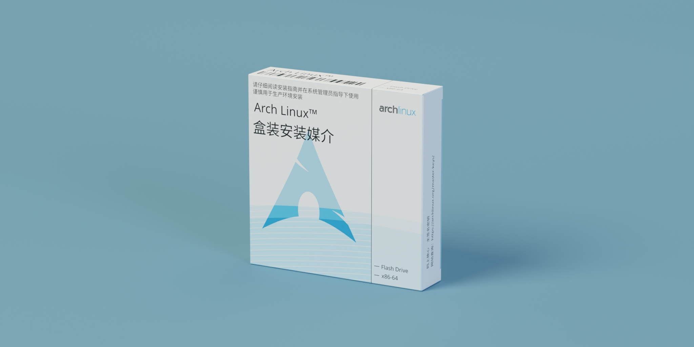
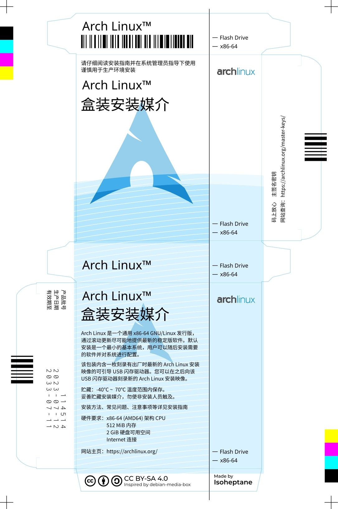
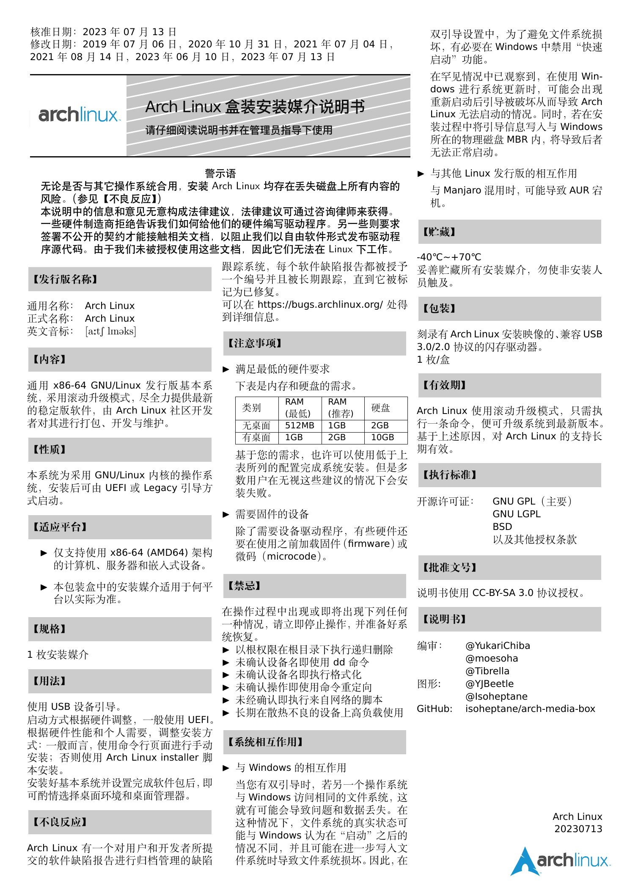

# Arch Linux Boxed Installation Media

> This is a fork of [Isoheptane/arch-media-box](https://github.com/Isoheptane/arch-media-box), with Japanese and English versions added.

A graphic design for a boxed Arch Linux installation medium, inspired by the [Debian Medicine Box](https://github.com/moesoha/debian-media-box).

| Box                   | Instruction                                   |
| --------------------- | --------------------------------------------- |
|  |  |

The Arch Linux logo doesn't look much like a certain medicine, but since the Debian boxed installation medium meme already exists, a boxed Arch Linux installation medium seems fine too.

## Repository layout

| Directory        | Language           | Box (print-ready, CMYK) | Box (SVG)                                   | Instruction                                |
| ---------------- | ------------------ | ----------------------- | ------------------------------------------- | ------------------------------------------ |
| `cn (original)/` | Chinese (original) | `box_cmyk.pdf`          | `box_source.svg`, `box.svg` (text as paths) | `instruction.tex`                          |
| `en/`            | English            | `box_cmyk_en.pdf`       | `box_en.svg`                                | `instruction_en.tex`, `instruction_en.pdf` |
| `ja/`            | Japanese           | `box_cmyk_ja.pdf`       | `box_ja.svg`                                | `instruction_ja.tex`, `instruction_ja.pdf` |

Shared images used by the instruction sheets are in `assets/`, and the preview images above are in `media/`.

## Usage

Download the `box_cmyk*.pdf` for your language and print it.

The instruction sheets are built with `xelatex` from the `.tex` files, or you can download them from the GitHub Actions artifacts.

## Source files

Inkscape cannot use the CMYK color mode, so the workflow is to export an RGB PDF, then import it into Scribus and convert it to CMYK.

In the original Inkscape SVGs (`cn (original)/box_source.svg`), text is not converted to paths, so the corresponding fonts must be installed on your system. The fonts used by the boxes are:

- Noto Sans
- Noto Sans CJK SC
- Montserrat
- Inconsolata

Compiling the instruction sheets requires the following fonts:

- DejaVu Sans (Chinese and English)
- zhsong (Chinese)
- Harano Aji Gothic (Japanese)

## License

This work is licensed under [CC BY-SA 4.0](https://creativecommons.org/licenses/by-sa/4.0/).
